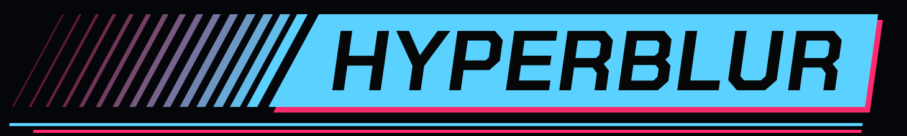

<p align="center">
  <a href="https://hyperblur.dev">
    <picture>
      <source media="(prefers-color-scheme: dark)" srcset="brand/hyperblur-logo-dark-bg.svg">
      <source media="(prefers-color-scheme: light)" srcset="brand/hyperblur-logo-light-bg.svg">
      
    </picture>
  </a>
</p>

<p align="center">
  <strong>Visual effects for React, one command away.</strong><br>
  1,000 free copy-paste effects, components and page blocks. No package to install, the code lands in your project.
</p>

<p align="center">
  <a href="https://hyperblur.dev">Website</a> ·
  <a href="https://hyperblur.dev/effects">Browse the catalog</a> ·
  <a href="https://hyperblur.dev/docs/installation">Docs</a> ·
  <a href="https://hyperblur.dev/docs/agents">Use with AI agents</a>
</p>

<p align="center">
  
  <a href="https://www.npmjs.com/package/@hyperblur/mcp"></a>
</p>

## Quick start

Install any item with the shadcn CLI. It writes one file into your project, with no dependency besides React:

```sh
npx shadcn@latest add https://hyperblur.dev/r/glitch-text.json
```

Then import it:

```tsx
import { GlitchText } from "@/components/hyperblur/glitch-text";

export default function Page() {
  return <GlitchText text="Hyperblur" />;
}
```

Every item has a page with a live preview, props, source code and the install command: https://hyperblur.dev/effects

## What is inside

- **1,000 items in 49 categories** across effects, components and page blocks.
- **Effects:** text, motion and reveals, overlays and backgrounds, hover and pointer, transitions, buttons, loaders, micro interactions.
- **Components:** website elements, charts, lists and tables, sidebars, dashboards, app UI, modals, forms, payments, maps.
- **Page blocks:** hero sections, features, bento, social proof, pricing, FAQ, footers, navigation, auth, blog, ecommerce, checkout.
- **One file per item.** Read it, change it, own it. Metadata lives in `meta.ts` and the demo in `demos.tsx`.

Looking for full-page templates, cinematic heroes and app screens? See [Hyperblur Pro](https://hyperblur.dev/pro). This repository is the free catalog and stays free.

## Use it with your coding agent

Hyperblur ships an [MCP](https://modelcontextprotocol.io) server, so Claude Code, Cursor, Claude Desktop and other MCP clients can search the catalog, read an item's props and install it for you.

```sh
claude mcp add hyperblur -- npx -y @hyperblur/mcp
```

Other clients: run `npx -y @hyperblur/mcp` as a stdio server. Setup for each client is in [`packages/mcp`](packages/mcp). The server is also listed in the official MCP Registry as `io.github.Hyperblur/mcp`.

For Claude Code there is a plugin that bundles the server and a skill:

```sh
claude plugin install hyperblur --marketplace Hyperblur/Hyperblur
```

You can also paste an item's prompt from its page into any coding agent, with no server needed.

## Repository layout

- `web/src/registry/`: the free catalog, one file per item in `web/src/registry/hyperblur`.
- `packages/mcp`: the `@hyperblur/mcp` server.
- `plugins/hyperblur`: the Claude Code plugin.
- `brand/`: logo, mark, favicon and avatars with a usage guide. These are not covered by the MIT license, see `TRADEMARK.md`.
- `launch/`: copy and checklists for listing Hyperblur on directories.

## Contribute

Add or edit an effect in `web/src/registry/hyperblur`, describe it in `web/src/registry/meta.ts`, and run `node web/scripts/check-css.mjs` to make sure CSS names stay unique. The registry JSON at https://hyperblur.dev/r is built from this folder. Issues and pull requests are welcome.

## License

MIT. Everything in this repository, including every effect, component and block in the catalog, is free to use in personal and commercial projects.
